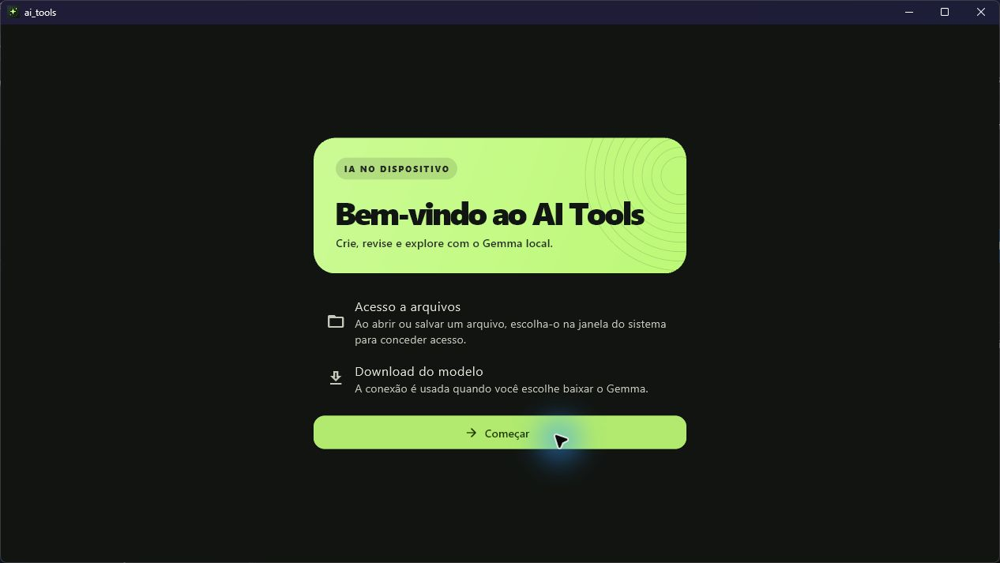
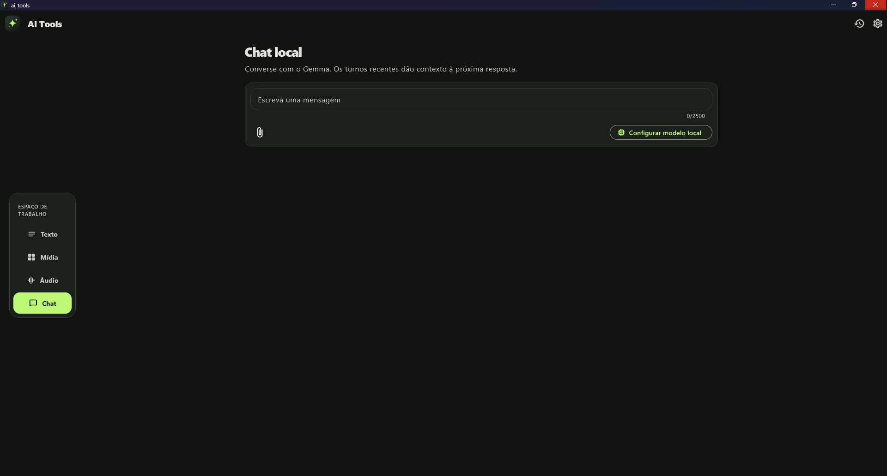

# AI Tools

Aplicativo Flutter com Gemma 4 E2B via Flutter Edge AI e LiteRT-LM.

- **Catálogo** · Busca em todas as ferramentas, favoritos salvos no dispositivo e exemplos de prompt.
- **Texto** · Geração, revisão, verificação de clareza e coerência, resumo, tradução e código.
- **Mídia** · Criação de conceitos, prompts e roteiros, exportação de cartaz PNG e clipe MP4 com duração escolhida no momento da criação, filtro em preto e branco, exportação integral de vídeos ou recorte opcional e verificação visual. Para analisar vídeos, o Gemma recebe até três quadros amostrados.
- **Áudio** · Roteiros, narração e normalização de volume com saída exclusivamente MP3. O limite de 30 segundos se aplica à análise pelo Gemma.
- **Importação** · Anexe imagens, vídeos, áudio e documentos no chat. As ferramentas também aceitam anexos compatíveis com a tarefa. Documentos aceitos incluem TXT, Markdown, CSV, TSV, JSON e DOCX com até 6.000 caracteres de texto.
- **Chat** · Conversa local. Até cinco turnos recentes, abreviados e configuráveis, são enviados como contexto a cada pergunta. A conversa permanece aberta enquanto o app está em execução.
- **Configurações** · Ajuste a taxa de bits do MP3, o contexto do chat e a gravação de histórico. Gerencie os resultados locais, instale ou remova o Gemma e restaure as preferências.

## Capturas de tela

Capturas da versão Windows do AI Tools.

### Boas-vindas

A primeira abertura explica como selecionar arquivos pelo sistema e quando o aplicativo usa a conexão para baixar o Gemma.



### Chat local

No chat, use o campo de mensagem para escrever e o clipe para anexar documentos, imagens, áudio ou vídeo. A captura mostra o botão **Configurar modelo local**, exibido enquanto o Gemma ainda não está pronto.



## Plataformas

| Plataforma | Gemma local | Exportações |
| --- | --- | --- |
| Android | Texto, imagem, vídeo por quadros e áudio | PNG, JPG, MP3 e MP4 |
| Windows, macOS e Linux | Texto, imagem, vídeo por quadros e áudio | PNG, JPG, MP3 e MP4 |
| iOS | Texto, imagem, vídeo por quadros e áudio | PNG, JPG, MP3 e MP4 |

O aplicativo requer macOS 14 ou posterior no Mac.

No desktop, a importação de áudio comprimido e as exportações MP3 e MP4 usam o FFmpeg no PATH. A narração no Linux também usa eSpeak NG. Para compilar o extrator de quadros no Linux, instale as bibliotecas de desenvolvimento libavformat, libavcodec, libavutil, libswscale e libjpeg.

## Android

Use um dispositivo ARM64 com Android 11 (API 30) ou superior. Selecione **Configurações → Modelo local → Baixar modelo** para instalar o Gemma. A primeira instalação exige internet e espaço para cerca de 2,6 GB de pesos.

```sh
flutter pub get
flutter run -d <id-do-dispositivo>
flutter build apk --debug --target-platform android-arm64
```

O APK fica em `build/app/outputs/flutter-apk/app-debug.apk`.

[Flutter Edge AI · entradas multimodais](https://flutteredge.ai/docs/multimodal)


## GitHub Releases

Envie uma tag no formato `v1.2.3` ou selecione uma tag existente ao executar **AI Tools - Build e Release** na aba Actions. O workflow compila o commit apontado pela tag e publica o APK ARM64, o DEB amd64 para Ubuntu 24.04, o instalador Windows x64, o DMG e o IPA junto com `SHA256SUMS.txt`. A release só é publicada depois que os cinco pacotes são gerados.

O IPA sai sem assinatura e exige assinatura e provisionamento para instalação. O DMG não é notarizado e o APK usa a chave de depuração do projeto.

## Ícones

Os arquivos de origem ficam em `assets/branding`. Após alterá-los, execute
`dart run flutter_launcher_icons` para atualizar Android, iOS, Windows e
macOS. O runner Linux carrega o mesmo ícone dos assets Flutter na janela GTK.

